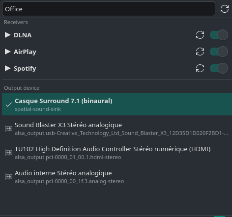
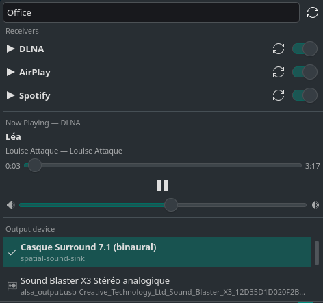
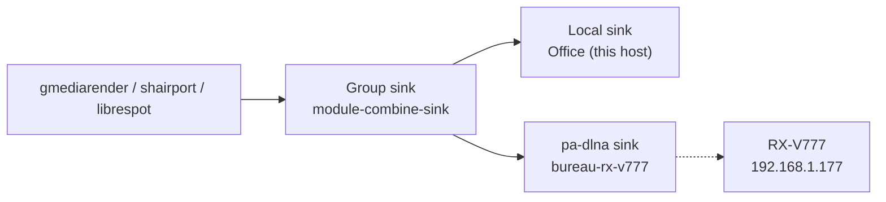

# Bureau Receivers — KDE Plasma applet

***English** · [Français](README.fr.md)*

A Plasma 6 widget that turns your Linux machine into a **multi-protocol audio
receiver** — DLNA, AirPlay, and Spotify Connect — with live output device
switching, player controls, and track history.

<p align="center">
  
</p>

<p align="center">
  
  
</p>

## What it does

- **Receives audio from three protocols**:
  - **DLNA** via [`gmediarender`][gmr] — from Synology Audio Station, DS audio, BubbleUPnP, etc.
  - **AirPlay** via [`shairport-sync`][sps] — from iPhone, iPad, Mac
  - **Spotify Connect** via [`librespot`][lrs] — from the Spotify app on any device
- **Switches output device live** — click a device in the applet, the active
  stream moves to the new sink with `pactl move-sink-input`. No restart, no gap.
- **Player controls** in the applet:
  - Now playing: track title, artist, album
  - Timeline with position/duration (seek for DLNA)
  - Play/pause (DLNA via UPnP SOAP)
  - Volume slider (all protocols, via PulseAudio)
- **Receiver management**: on/off toggles, restart buttons, editable name
  (one name updates all three with protocol suffixes)
- **Track history**: every track logged to `~/.config/bureau-receivers/history.tsv`
  with timestamp, protocol, title, artist, album. Indefinite, deduplicated.
- **Multi-room**: save named groups (this host + 1..N remote DLNA/AirPlay
  devices) and switch to one with a single click. See [Multi-room](#multi-room).

[gmr]: https://github.com/hzeller/gmrender-resurrect
[sps]: https://github.com/mikebrady/shairport-sync
[lrs]: https://github.com/librespot-org/librespot

## Multi-room

Play the same stream on the local host **and** on several remote DLNA or AirPlay
devices at once — for example `Office (this host) + RX-V777 (192.168.1.177)`.



### How it works

A virtual **group sink** is created with PipeWire's PulseAudio-compatible
`module-combine-sink`, with one member per device. Receiver streams
(`gmediarender`, `shairport-sync`, `librespot`) are then moved onto that sink,
so every member plays the same audio.

| Device type | Sink is provided by | Notes |
|---|---|---|
| Local host | any PipeWire/PulseAudio sink | the default sink is used as the `local` member |
| DLNA | `pa-dlna` (AUR) | one `pa-dlna` process per device, one sink each |
| AirPlay | `module-raop-sink` (`pipewire-zeroconf`) | one config drop-in per device |

### Synchronisation is approximate

Consumer AV receivers buffer audio internally and expose no clock-sync API, so
the rooms will be offset by roughly **100–500 ms**. This is fine for background
music; it is not sample-accurate. True sample-accurate sync needs a client
running on each device (Snapcast), which an AV receiver cannot do.

### Requirements

```bash
# DLNA remote outputs
yay -S pa-dlna

# AirPlay remote outputs
sudo pacman -S pipewire-zeroconf

# Discovery
sudo pacman -S socat avahi
```

`pa-dlna` and `pipewire-zeroconf` are both optional: without them, groups simply
fall back to the local sink plus whichever devices are still available.

### Usage

Add devices — the applet's **+** button discovers and saves them, or do it by hand:

```bash
gmediarender-output --discover                      # scan the LAN
# dlna    Living Room   192.168.1.50   49494   living-room
# airplay RX-V777       192.168.1.177  1024    rx-v777

gmediarender-output --add-device airplay:RX-V777:192.168.1.177:1024
gmediarender-output --devices                       # list known devices
```

Create and apply a group:

```bash
gmediarender-output --group-save "Bureau+RXV" local,rx-v777
gmediarender-output --groups                        # list, with applied flag
gmediarender-output --group-apply "Bureau+RXV"      # bring up + switch
gmediarender-output --group-unapply                 # back to single-room
```

In the applet, the **Multi-room** section lists saved groups; click one to apply
it (checkmark = active). The **+** button discovers devices, the trash button
stops multi-room, and each known device has an on/off switch.

### Troubleshooting

| Symptom | Cause |
|---|---|
| `pa-dlna not installed` | install `pa-dlna` from the AUR for DLNA outputs |
| `PipeWire RAOP module not found` | install `pipewire-zeroconf`, then re-apply the group |
| Audio restarts when applying a group | AirPlay sinks need a PipeWire restart (config drop-in) |
| Rooms drift apart by a few hundred ms | expected; see *Synchronisation is approximate* |
| Device not discovered | check `avahi-daemon` is running and the device is on the same subnet |

## Requirements

| Required | Why |
|---|---|
| KDE Plasma ≥ 6 | the applet uses Plasma 6 QML imports |
| PipeWire or PulseAudio | audio routing via `pactl` |
| `gmediarender` (AUR: `gmrender-resurrect-git`) | DLNA renderer |
| `shairport-sync` (AUR: `shairport-sync-git`) | AirPlay receiver |
| `librespot` (AUR: `librespot-git`) | Spotify Connect receiver |
| `nqptp` (AUR: `nqptp-git`) | PTP clock for shairport-sync |
| `playerctl` | optional, for Spotify metadata |
| GStreamer plugins | decoding FLAC/MP3/AAC |

Tested on Manjaro KDE + PipeWire.

## Installation

```bash
git clone https://github.com/rginon314/dlna-gmediarender-kde.git
cd dlna-gmediarender-kde
./install.sh
```

`install.sh` does everything:

1. Installs `gmrender-resurrect-git` from the AUR + GStreamer codec plugins
2. Installs the `gmediarender-output` CLI helper to `~/.local/bin/`
3. Creates the renderer config at `~/.config/gmediarender.conf`
4. Installs a **user systemd service** for `gmediarender`
5. Installs the Plasma applet and reloads `plasmashell`

After it finishes, add the widget to your panel:

> Right-click the panel → **Add Widgets** → search **"DLNA gmediarender"**

For AirPlay and Spotify, install them separately:
```bash
# AirPlay (requires nqptp first)
yay -S nqptp-git shairport-sync-git
sudo systemctl enable --now avahi-daemon nqptp

# Spotify Connect
yay -S librespot-git playerctl
```

Then copy the systemd units and configs from this repo's `systemd/` directory.

## Usage

### From the desktop

Click the applet icon → a panel opens with:
- **Receivers section**: on/off switches, restart buttons for each protocol
- **Name field**: double-click to edit, updates all three receivers
- **Now Playing**: track info, timeline, play/pause, volume
- **Output devices**: click to switch the active output

### From the terminal

```bash
gmediarender-output --services          # list receivers with on/off state
gmediarender-output --sinks             # list output devices
gmediarender-output --active-player     # which protocol is playing
gmediarender-output --player-info DLNA  # track info for a protocol
gmediarender-output --player DLNA pause # pause DLNA playback
gmediarender-output --player DLNA seek 120  # seek to 120s
gmediarender-output --volume DLNA 75    # set volume to 75%
gmediarender-output --toggle gmediarender.service  # start/stop DLNA
gmediarender-output --restart-all       # restart all receivers
gmediarender-output --rename-all "Bureau"  # rename all receivers
gmediarender-output --history            # last 20 tracks
gmediarender-output --history 50         # last 50 tracks
```

### From the source devices

- **Synology**: DS audio / Audio Station → select **"Bureau (DLNA)"**
- **Apple**: AirPlay icon → select **"Bureau (AirPlay)"**
- **Spotify**: device icon → select **"Bureau (Spotify)"**

## Protocol support matrix

| Feature | DLNA | AirPlay | Spotify |
|---|---|---|---|
| Receive audio | ✅ | ✅ | ✅ |
| Track title/artist/album | ✅ UPnP | ✅ D-Bus | ❌ no MPRIS |
| Timeline (position/duration) | ✅ UPnP | ✅ wall-clock | ❌ |
| Play/pause | ✅ UPnP SOAP | ❌ source-controlled | ❌ source-controlled |
| Seek | ✅ UPnP SOAP | ❌ | ❌ |
| Next/previous | ❌ renderer limitation | ❌ source-controlled | ❌ source-controlled |
| Volume | ✅ PulseAudio | ✅ PulseAudio | ✅ PulseAudio |
| Live output switch | ✅ | ✅ | ✅ |
| Track history | ✅ | ✅ | ❌ |

## Files installed

| File | Purpose |
|---|---|
| `~/.local/bin/gmediarender-output` | CLI helper |
| `~/.config/gmediarender.conf` | DLNA renderer config |
| `~/.config/shairport-sync.conf` | AirPlay receiver config |
| `~/.config/systemd/user/gmediarender.service` | DLNA systemd unit |
| `~/.config/systemd/user/shairport-sync.service` | AirPlay systemd unit |
| `~/.config/systemd/user/librespot.service` | Spotify systemd unit |
| `~/.config/bureau-receivers/history.tsv` | track history |
| `~/.local/share/plasma/plasmoids/org.gmediarender.kde/` | the applet |
| `~/.local/share/icons/hicolor/scalable/apps/org.gmediarender.kde.svg` | icon |

## Uninstall

```bash
systemctl --user disable --now gmediarender shairport-sync librespot
rm -rf ~/.local/share/plasma/plasmoids/org.gmediarender.kde
rm -f ~/.local/bin/gmediarender-output
rm -f ~/.config/gmediarender.conf ~/.config/shairport-sync.conf
rm -f ~/.config/systemd/user/gmediarender.service ~/.config/systemd/user/shairport-sync.service
rm -f ~/.config/systemd/user/librespot.service
rm -rf ~/.config/bureau-receivers
systemctl --user daemon-reload
```

## License

MIT